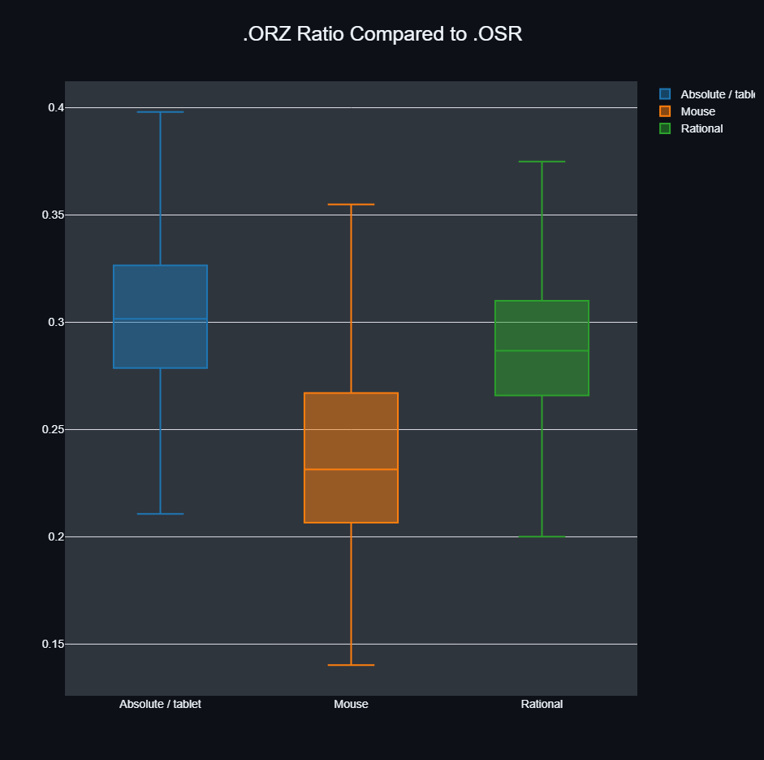

# ORZ format

.orz is a lossless compression format to store osu replay frames. [SPEC_OUTLINE.md](SPEC_OUTLINE.md) outlines the format.

**The format is specified, but V0 is not pinned quite yet.**\
**The priors are still being trained, once they are finished the format is ready.**

Replay set: https://drive.google.com/file/d/1i2oe929loEzhvCfRYG-DeZZQ_YouaBYD/view

Sizes are totals over the whole set: the .osr replay data (LZMA) in, the .orz out, in bytes.

# osu!
27.496% of the original size (4,163 replays)

226,602,499 -> 62,307,831

# taiko
45.349% of the original size (457 replays)

2,794,463 -> 1,267,266

# mania
46.617% of the original size (1,562 replays)

14,573,760 -> 6,793,898

# fruit
44.848% of the original size (373 replays)

10,419,674 -> 4,673,034

# Total
29.498% of the original size (6,555 replays)

254,390,396 -> 75,042,029
