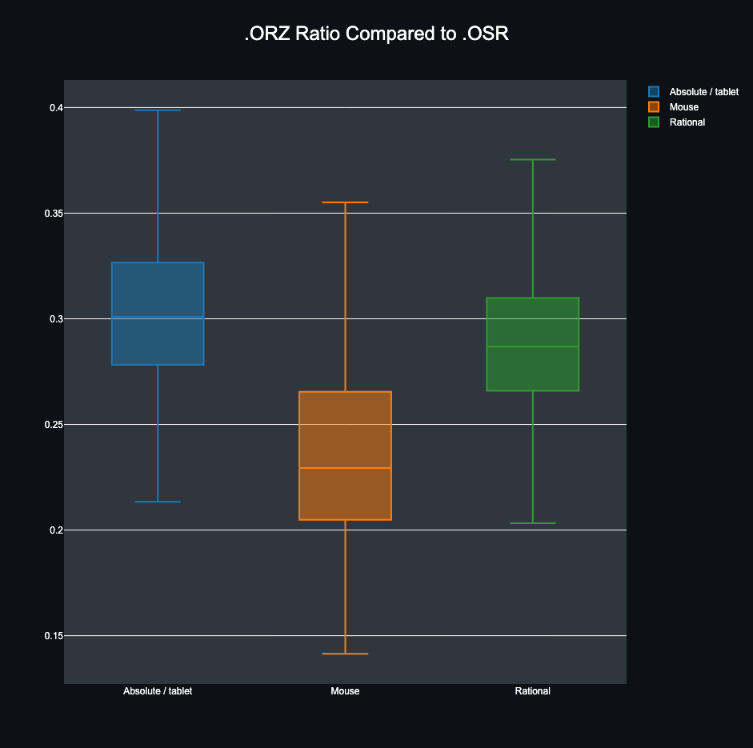

# ORZ format

.orz is a lossless compression format to store osu replay frames. [SPEC_OUTLINE.md](SPEC_OUTLINE.md) outlines the format.

**The format is specified, but V0 is not pinned quite yet.**\
**The priors are still being trained, once they are finished the format is ready.**

Replay set: https://drive.google.com/file/d/1i2oe929loEzhvCfRYG-DeZZQ_YouaBYD/view

Sizes are totals over the whole set, in bytes:

- **raw**: the frames as the raw required binary, 16 bytes each (int delta, float x, float y, u32 keys)
- **.osr**: the replay data inside the .osr (the frames as text, LZMA compressed)
- **.orz**: the replay data as .orz, at each compression priority (SIZE, the default; BALANCED; SPEED)
- **encode / decode**: the time from the frame values and back to them, summed over the replays (one thread each, 8 at
  once). Each replay runs all four formats interleaved, in a rotating order, the best of 3 each. .osr: the replay text
  written and LZMA compressed with osu!'s settings, then decompressed and parsed; .orz: the encoder from the frames, the
  decoder to the frames (no text either way)

# osu!
4,163 replays, 45,036,306 frames

| | bytes | of raw | of .osr | encode | decode |
|---|---:|---:|---:|---:|---:|
| raw | 720,580,896 | 100% | | | |
| .osr | 226,602,499 | 31.45% | 100% | 294.34 s (70.7 ms) | 15.11 s (3.63 ms) |
| .orz-SIZE | 61,921,830 | **8.59%** | **27.33%** | 125.03 s (30.0 ms) | 55.14 s (13.25 ms) |
| .orz-BALANCED | 67,461,668 | 9.36% | 29.77% | 102.95 s (24.7 ms) | 32.04 s (7.70 ms) |
| .orz-SPEED | 75,729,997 | 10.51% | 33.42% | 88.70 s (21.3 ms) | 17.94 s (4.31 ms) |

128 bits a frame raw, 40.3 as .osr, 11.0 as .orz-SIZE, 12.0 as .orz-BALANCED, 13.5 as .orz-SPEED.

# taiko
457 replays, 4,064,380 frames

| | bytes | of raw | of .osr | encode | decode |
|---|---:|---:|---:|---:|---:|
| raw | 65,030,080 | 100% | | | |
| .osr | 2,794,463 | 4.30% | 100% | 25.15 s (55.0 ms) | 0.39 s (0.85 ms) |
| .orz-SIZE | 1,237,109 | **1.90%** | **44.27%** | 1.39 s (3.0 ms) | 1.30 s (2.85 ms) |
| .orz-BALANCED | 1,617,479 | 2.49% | 57.88% | 0.73 s (1.6 ms) | 0.64 s (1.40 ms) |
| .orz-SPEED | 2,086,189 | 3.21% | 74.65% | 0.40 s (0.9 ms) | 0.26 s (0.56 ms) |

# mania
1,562 replays, 16,344,692 frames

| | bytes | of raw | of .osr | encode | decode |
|---|---:|---:|---:|---:|---:|
| raw | 261,515,072 | 100% | | | |
| .osr | 14,573,760 | 5.57% | 100% | 108.50 s (69.5 ms) | 2.36 s (1.51 ms) |
| .orz-SIZE | 6,643,539 | **2.54%** | **45.59%** | 5.61 s (3.6 ms) | 5.21 s (3.33 ms) |
| .orz-BALANCED | 8,185,006 | 3.13% | 56.16% | 3.18 s (2.0 ms) | 2.75 s (1.76 ms) |
| .orz-SPEED | 9,588,713 | 3.67% | 65.79% | 1.78 s (1.1 ms) | 1.12 s (0.72 ms) |

# fruit
373 replays, 3,292,540 frames

| | bytes | of raw | of .osr | encode | decode |
|---|---:|---:|---:|---:|---:|
| raw | 52,680,640 | 100% | | | |
| .osr | 10,419,674 | 19.78% | 100% | 20.11 s (53.9 ms) | 0.91 s (2.44 ms) |
| .orz-SIZE | 4,650,899 | **8.83%** | **44.64%** | 2.77 s (7.4 ms) | 2.53 s (6.78 ms) |
| .orz-BALANCED | 4,951,605 | 9.40% | 47.52% | 1.84 s (4.9 ms) | 1.46 s (3.92 ms) |
| .orz-SPEED | 5,503,868 | 10.45% | 52.82% | 1.16 s (3.1 ms) | 0.73 s (1.97 ms) |

# Total
6,555 replays, 68,737,918 frames

| | bytes | of raw | of .osr | encode | decode |
|---|---:|---:|---:|---:|---:|
| raw | 1,099,806,688 | 100% | | | |
| .osr | 254,390,396 | 23.13% | 100% | 448.10 s (68.4 ms) | 18.76 s (2.86 ms) |
| .orz-SIZE | 74,453,377 | **6.77%** | **29.27%** | 134.81 s (20.6 ms) | 64.18 s (9.79 ms) |
| .orz-BALANCED | 82,215,758 | 7.48% | 32.32% | 108.71 s (16.6 ms) | 36.88 s (5.63 ms) |
| .orz-SPEED | 92,908,767 | 8.45% | 36.52% | 92.03 s (14.0 ms) | 20.06 s (3.06 ms) |
