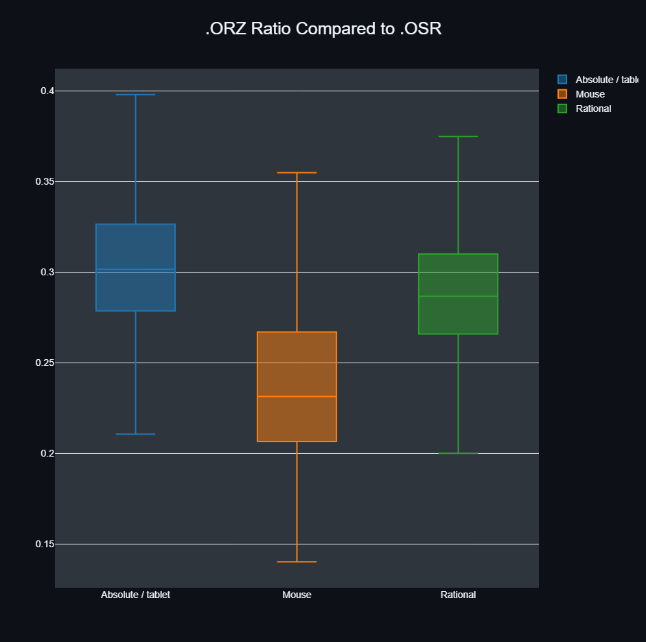

# ORZ format

.orz is a lossless compression format to store osu replay frames. [SPEC_OUTLINE.md](SPEC_OUTLINE.md) outlines the format.

**The format is specified, but V0 is not pinned quite yet.**\
**The priors are still being trained, once they are finished the format is ready.**

To trade some compression for faster frame decoding, set `ENCODE_FAST_FRAME_DECODE` on the encoder state:

```cpp
orz::orz_state encoder;
encoder.options |= orz::ENCODE_FAST_FRAME_DECODE;
orz::osr_to_orz(input, packed, encoder);
```

`replay_data_to_orz` accepts the same state option. The encoder stores the profile in the `.orz` header;
`orz_decode_frames` selects it automatically. Fast streams use version 1 and require a reader that supports their profile.
Normal streams and verbatim fallbacks use version 0. The fast profile skips adaptive probability refinement
while retaining all contexts, counters and mixer weights.

For greater decode speed at a larger size cost, use `ENCODE_FASTEST_FRAME_DECODE` instead. This profile codes
each model's decisions directly from shared adaptive counters, without context mixing or probability refinement.
It takes precedence if both encoder options are set. Readers that support only the fast profile reject fastest
streams; readers supporting fastest also decode normal and fast streams. Verbatim fallbacks clear both profile flags.

For repeated frame decoding, retain the table storage across calls to avoid repeated allocations:

```cpp
orz::_table_memory tables;
orz::_decoded_orz decoded;
for (const auto& packed : replays)
    orz::orz_decode_frames(packed, decoded, tables);
```

The decoder resets the adaptive model state for each replay. Both examples omit error handling.

Replay set: https://drive.google.com/file/d/1i2oe929loEzhvCfRYG-DeZZQ_YouaBYD/view

Sizes are totals over the whole set: the .osr replay data (LZMA) in, the .orz out, in bytes.

# osu!
27.300% of the original size (4,163 replays)

226,602,499 -> 61,863,334



# taiko
44.865% of the original size (457 replays)

2,794,463 -> 1,253,735

# mania
46.118% of the original size (1,562 replays)

14,573,760 -> 6,721,119

# fruit
44.717% of the original size (373 replays)

10,419,674 -> 4,659,337

# Total
29.285% of the original size (6,555 replays)

254,390,396 -> 74,497,525
